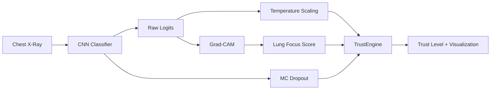

# A Calibrated and Explainable Deep Learning Framework for Chest X-Ray Pneumonia Detection

[]
[](LICENSE)
A research-grade, production-quality Python framework for **binary chest X-ray classification** (Normal vs Pneumonia) with **probability calibration**, **Grad-CAM explainability**, **Monte Carlo Dropout uncertainty**, and **trust-aware analysis**.

---

## Features

- **Multi-architecture CNN support** — Custom CNN, ResNet18, VGG16, DenseNet121, EfficientNet-B0
- **Post-hoc calibration** — Temperature Scaling for reliable confidence estimates
- **Grad-CAM explainability** — Visual heatmaps overlaid on X-rays
- **Uncertainty estimation** — Monte Carlo Dropout variance
- **Trust scoring** — Combines calibration, explanation focus, uncertainty, and ensemble agreement
- **OOD detection** — Flags unreliable predictions with low confidence and high uncertainty
- **End-to-end pipeline** — Train → Calibrate → Evaluate → Infer

---

## Architecture



See [docs/architecture.md](docs/architecture.md) for the full component diagram.

---

## Project Structure

```
├── configs/           # Configuration and paths
├── data/              # Dataset (train/val/test)
├── datasets/          # Dataset, transforms, DataLoaders
├── models/            # CNN models and ensemble agreement
├── training/          # Training scripts
├── evaluation/        # Metrics, calibration, evaluation
├── explainability/    # Grad-CAM, uncertainty, trust scoring
├── inference/         # Single-image prediction pipeline
├── utils/             # I/O, logging, helpers
├── scripts/           # Shell wrappers and pipeline runner
├── docs/              # Architecture, methodology, results
├── tests/             # Smoke and import tests
└── checkpoints/       # Saved model weights
```

---

## Installation

**Requirements:** Python 3.10+, PyTorch 2.0+

```bash
git clone https://github.com/HARIKRISHNA39/Trustworthy-Pneumonia-Detection-XAI
cd Trustworthy-Pneumonia-Detection-XAI
pip install -r requirements.txt
```

### Dataset Setup

Download the [Chest X-Ray Pneumonia dataset](https://www.kaggle.com/datasets/paultimothymooney/chest-xray-pneumonia) and organize as:

```
data/
├── train/  (NORMAL/, PNEUMONIA/)
├── val/    (NORMAL/, PNEUMONIA/)
└── test/   (NORMAL/, PNEUMONIA/)
```

Split train/val from the Kaggle training folder:

```bash
python scripts/prepare_dataset.py path/to/chest_xray/train --val_ratio 0.15
```

See [data/README.md](data/README.md) for details.

---

## Training

```bash
python -m training.train --model_type resnet18 --epochs 15
# or
python train.py --model_type resnet18 --epochs 15
# or
bash scripts/train.sh --model_type resnet18 --epochs 15
```

Saves the best model to `checkpoints/chestxray_best.pt` and training curves to `outputs/training_curves.png`.


---

## Calibration

```bash
python -m evaluation.calibrate
```

Fits temperature scaling on the validation set and saves reliability diagrams:


---

## Evaluation

```bash
python -m evaluation.evaluate
python -m evaluation.evaluate --trust_eval   # include TrustScore analysis
```


---

## Inference

Run the full trustworthy pipeline on a single image:

```bash
python -m inference.predict data/test/NORMAL/IM-0001-0001.jpeg
# or
python visualize.py data/test/NORMAL/IM-0001-0001.jpeg
```

**Outputs:** predicted class, raw/calibrated confidence, uncertainty, Grad-CAM overlay, TrustScore, and trust level.


### Programmatic API

```python
from inference.api import predict

result = predict("path/to/xray.jpg")
print(result["predicted_class"], result["trust_level"])
```

---

## Explainability Pipeline

| Step | Module | Output |
|------|--------|--------|
| 1 | MC Dropout | Mean prediction + variance |
| 2 | Temperature Scaling | Calibrated confidence |
| 3 | Grad-CAM | Spatial heatmap |
| 4 | Lung segmentation | FocusScore |
| 5 | TrustEngine | TrustScore + OOD flag |

TrustScore distribution on the test set:


---

## Full Pipeline

```bash
python scripts/run_pipeline.py
# train → calibrate → evaluate
```

---

## Testing

```bash
python -m pytest tests/ -v
```

---

## Citation

If you use this project in your research, please cite:

```bibtex
@software{chest_xray_trustworthy_dl2026,
  title   = {Trustworthy Deep Learning System for Chest X-ray Pneumonia Detection using Explainable AI},
  author  = {Trustworthy Deep Learning Research Team},
  year    = {2026},
  license = {MIT},
  url     = {https://github.com/your-org/chest-xray-trustworthy-dl}
}
```

See also [CITATION.cff](CITATION.cff).

---

## Authors

**Trustworthy Deep Learning Research Team**

Research project: *Trustworthy Deep Learning System for Chest X-ray Pneumonia Detection using Explainable AI*

---

## License

This project is licensed under the [MIT License](LICENSE).

---

## Documentation

- [Architecture](docs/architecture.md)
- [Methodology](docs/methodology.md)
- [Results](docs/results.md)
- [Contributing](CONTRIBUTING.md)
