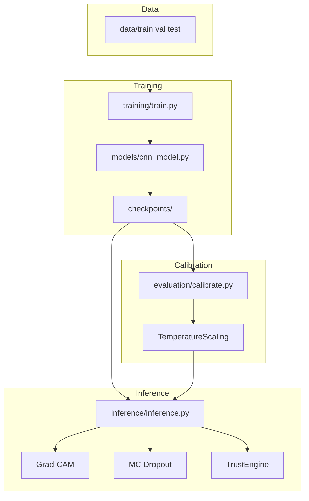

# System Architecture

## Overview

The system implements a trustworthy chest X-ray screening pipeline with four core layers:

1. **Classification** — CNN backbone (ResNet18 default) for Normal vs Pneumonia prediction
2. **Calibration** — Post-hoc temperature scaling on validation logits
3. **Explainability** — Grad-CAM heatmaps and lung-region focus validation
4. **Trust Assessment** — MC Dropout uncertainty, ensemble agreement, and TrustScore

## Component Diagram

## Module Layout

| Package | Responsibility |
|---------|----------------|
| `configs/` | Paths, hyperparameters, filenames |
| `datasets/` | Dataset class, transforms, DataLoaders |
| `models/` | CNN architectures and ensemble agreement |
| `training/` | Training loop and CLI |
| `evaluation/` | Metrics, calibration, reliability diagrams |
| `explainability/` | Grad-CAM, uncertainty, trust scoring, lung masks |
| `inference/` | Single-image pipeline and API |
| `utils/` | I/O, logging, matplotlib helpers |

## Model Factory

All architectures are defined in `models/cnn_model.py`:

- Custom CNN
- ResNet18 (default)
- VGG16
- DenseNet121
- EfficientNet-B0

Binary classification uses a single logit with sigmoid activation.
